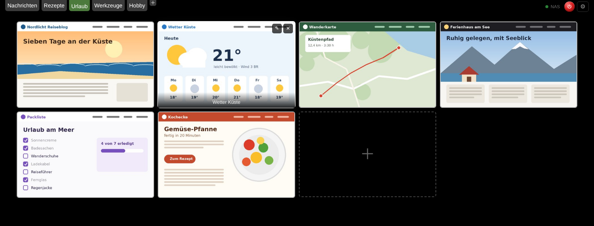

# NAS Speed Dial

**Ein Speed Dial für Chrome, der deine Gruppen und Links auf deiner eigenen Synology speichert – statt in irgendeiner Cloud.**

Aufgebaut wie die bekannten Speed-Dial-Erweiterungen: Gruppen als Reiter, große Kacheln mit Vorschaubildern der Seiten, alles per Maus sortierbar. Der Unterschied: Deine Daten liegen als eine einfache Datei auf deinem NAS. Kein Konto, kein fremder Server, keine Werbung.

*English summary below.*

---

## Funktionen

- **Gruppen als Reiter** – anlegen, umbenennen, per Maus sortieren
- **Kacheln mit Vorschaubild** – wird automatisch aufgenommen, wenn du die Seite besuchst; alternativ eigenes Bild oder Website-Symbol
- **Ziehen & Ablegen** – Kacheln sortieren oder auf einen anderen Reiter ziehen, um sie zu verschieben
- **Rechtsklick → „Zu Speed Dial hinzufügen“** – auf jeder Webseite oder jedem Link
- **Offene Tabs als Gruppe speichern** – praktisch für den Umzug von einer anderen Speed-Dial-Erweiterung
- **Speicherung auf der Synology** über WebDAV, mit **täglicher Sicherungskopie**
- **Funktioniert auch offline** – Änderungen werden nachgeholt, sobald das NAS wieder erreichbar ist
- **Mehrere PCs** – einfach überall dieselben NAS-Daten eintragen
- **Von unterwegs** über VPN (z. B. WireGuard der FRITZ!Box oder Tailscale)
- **PIN-Sperre** (4–6 Ziffern) mit rotem Ein/Aus-Knopf und optionaler Auto-Sperre
- Komplett auf Deutsch, dunkles Design

## Voraussetzungen

- Ein **Synology NAS** mit dem Paket **WebDAV Server** (kostenlos im Paket-Zentrum)
- **Google Chrome** oder ein anderer Chromium-Browser (Edge, Brave, Opera, Vivaldi)

Andere NAS oder Server mit WebDAV (z. B. QNAP, Nextcloud) sollten grundsätzlich auch funktionieren, sind aber nicht getestet.

## Installation

1. Oben auf **Code → Download ZIP** klicken und die Datei entpacken. Den Ordner danach nicht löschen – Chrome lädt die Erweiterung von dort.
2. In Chrome `chrome://extensions` öffnen.
3. Oben rechts den **Entwicklermodus** einschalten.
4. **Entpackte Erweiterung laden** und den entpackten Ordner auswählen.
5. Einen neuen Tab öffnen und auf **⚙** klicken, um das NAS zu verbinden.

Beim ersten Start sind schon ein paar **Beispielgruppen** (Nachrichten, Rezepte, Urlaub, Werkzeuge, Hobby) mit bekannten Seiten angelegt – zum Ausprobieren. Du kannst sie frei ändern oder löschen. Liegen auf deinem NAS schon eigene Daten, werden diese verwendet und die Beispiele nicht angelegt.

Die ausführliche Schritt-für-Schritt-Anleitung – inklusive Einrichtung der Synology – steht in **[ANLEITUNG.md](ANLEITUNG.md)**.

**Updates:** Neue Dateien in denselben Ordner kopieren, in `chrome://extensions` auf den runden Pfeil klicken und alle alten Speed-Dial-Tabs schließen.

## Datenschutz & Sicherheit

- Deine Gruppen und Links werden **nur** auf deinem NAS (`speeddial.json`) und als Zwischenspeicher in deinem Browser abgelegt. Die Erweiterung sendet nichts an andere Server.
- NAS-Benutzername und -Passwort werden nur im lokalen Speicher von Chrome abgelegt, nicht auf dem NAS.
- Empfehlung: Lege auf der Synology einen **eigenen Benutzer** an, der nur auf den einen Ordner und nur per WebDAV zugreifen darf.
- Die Verbindung im Heimnetz läuft über HTTP. **Gib den WebDAV-Port nicht ins Internet frei** – nutze für unterwegs ein VPN oder HTTPS (Port 5006 mit Zertifikat).
- Die **PIN-Sperre ist ein Sichtschutz**, keine Verschlüsselung. Die PIN selbst wird nicht gespeichert, nur ein Prüfwert (PBKDF2).

### Warum die Erweiterung diese Berechtigungen braucht

| Berechtigung | Wofür |
|---|---|
| Daten auf allen Websites (optional, wird beim Einrichten erfragt) | Verbindung zum NAS und Vorschaubilder der Seiten aufnehmen |
| Tabs | Adresse und Titel der offenen Tabs lesen (Vorschaubilder, „Offene Tabs als Gruppe speichern“) |
| Kontextmenüs | Rechtsklick „Zu Speed Dial hinzufügen“ |
| Speicher | Zwischenspeicher, Einstellungen und Zugangsdaten im Browser |
| Favicon | Website-Symbole als Kachelbild, solange es noch kein Vorschaubild gibt |

## Bekannte Grenzen

- Die PIN sperrt die Speed-Dial-Seite, nicht den ganzen Browser.
- Wird der Ordner zusätzlich von Synology Drive synchronisiert, meldet das NAS gelegentlich kurz einen Fehler; die Erweiterung wiederholt das Speichern dann automatisch.
- Vorschaubilder werden mit in der Datei gespeichert; bei sehr vielen Kacheln wird `speeddial.json` einige MB groß.

## Lizenz

[MIT](LICENSE) – frei nutzbar, veränderbar und weitergebbar, ohne Gewähr.

---

## English summary

**NAS Speed Dial** is a Chrome new-tab extension in the style of popular speed-dial add-ons (groups as tabs, large thumbnail tiles, drag & drop), but it stores all groups and links as a single JSON file **on your own Synology NAS via WebDAV** instead of a cloud service. It works offline with a local cache, syncs between several PCs, keeps a daily backup on the NAS, and offers an optional PIN lock. The interface is in German.

Install via `chrome://extensions` → Developer mode → *Load unpacked*, then open a new tab and enter your NAS's WebDAV address (e.g. `http://192.168.1.10:5005`), folder and a dedicated NAS user under ⚙. See [ANLEITUNG.md](ANLEITUNG.md) for the full (German) setup guide.
